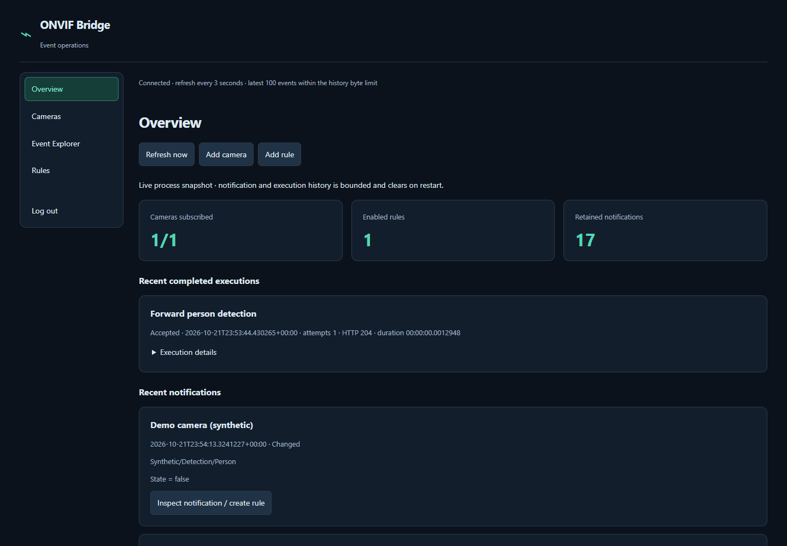
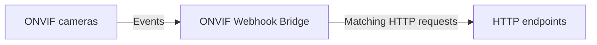

# ONVIF Webhook Bridge

[](https://hub.docker.com/r/dombrovskyi/onvif-webhook-bridge)
[](https://github.com/dombrovsky/onvif-webhook-bridge/pkgs/container/onvif-webhook-bridge)

Turn IP camera detection events into HTTP webhooks.

A lightweight, self-hosted Docker application that monitors ONVIF camera events and forwards matching notifications to configurable HTTP endpoints.

Configure cameras and event rules from a browser. No cloud account required.

[](docs/images/overview.png)

## Features

- **Multiple cameras:** independent ONVIF PullPoint connections, lease renewal and automatic reconnection.
- **Event Explorer:** inspect received topics, Source/Data/Key fields and retained XML, including false and unmatched notifications. Draft rules from observed events.
- **Configurable forwarding:** exact topic and optional text/boolean field matching, occurrence or transition modes, cooldowns, GET or POST, custom headers and literal JSON bodies.
- **Browser administration:** manage cameras and rules, check connection status, test saved HTTP actions, and inspect recent delivery results.
- **Persistent configuration:** cameras, rules and administrator setup survive container recreation in a SQLite data volume.
- **Self-contained deployment:** one .NET NativeAOT process serves the UI, polls cameras and delivers actions; no external database or frontend service is needed.
- **Protected administration:** one administrator, no default credentials, bounded sessions, CSRF protection and masked secret reads. Recoverable camera and webhook secrets require private storage; see [security](SECURITY.md).

## How it works



Add camera device-service URLs explicitly. The bridge discovers each camera's event service, subscribes, and keeps a bounded recent event history. Rules select which observations produce HTTP requests; a failed camera or action does not stop the other camera connections.

## Quick start

You need Git, Docker with Compose, and a Linux container engine on an amd64 or arm64 host. This procedure **builds locally**; it does not depend on an available registry image. See [deployment](docs/DEPLOYMENT.md#platforms-ci-and-releases) for supported platforms and the current [CI workflow](.github/workflows/ci.yml).

```sh
git clone https://github.com/dombrovsky/onvif-webhook-bridge.git
cd onvif-webhook-bridge
cp .env.example .env
```

Until the repository is public, cloning requires authorized GitHub access.

Edit `.env`: replace `ONVIF_ADMIN_USERNAME` with your chosen administrator name. Keep the local image and loopback bind defaults.

On a standard Linux Docker host, use **Bash** and `sudo` to create the default password file. Enter a unique password of at least 12 characters when prompted; input is hidden. See [password requirements](docs/ADMINISTRATION.md#initial-setup) for exact limits.

```bash
install -d -m 700 .local
read -r -s -p 'Administrator password (at least 12 characters): ' bridge_password
printf '\n'
printf '%s' "$bridge_password" | sudo install -m 600 -o 1654 -g 1654 /dev/stdin .local/administrator-password
unset bridge_password
```

This keeps the directory private to your account and the password file owned by the container's UID/GID **1654:1654**. Its path matches `ONVIF_ADMIN_PASSWORD_PATH` in `.env`. For NAS ACLs or rootless Docker, see [password-file permissions](docs/DEPLOYMENT.md#first-start).

Then run from the repository directory:

```sh
docker compose config --quiet
docker compose build
docker compose up -d
docker compose ps
```

Open [http://localhost:8080](http://localhost:8080) **on the Docker host** and sign in with the credentials you configured. The default is `127.0.0.1:8080` on the host, forwarding to port `8080` in the container. For a remote NAS, use a secure tunnel or the documented [HTTPS proxy setup](docs/DEPLOYMENT.md#https-and-trusted-certificates); changing the bind address alone does not secure remote access.

Compose creates the persistent `bridge-data` volume at `/data`. Keep it across upgrades and back it up securely. Administrator variables initialize only a new database; changing the password file later does not change the existing login. Keep the file available for Compose and use the documented [offline reset](docs/ADMINISTRATION.md#explicit-offline-password-reset) when needed.

### Forward your first event

1. In **Cameras**, choose **Add camera**, enter its ONVIF device-service URL and credentials, and enable the connection. **Test connectivity** checks reachability; wait for subscription status separately.
2. Open **Event Explorer**, generate a detection at the camera, and inspect the actual topic and fields. Event support depends on the camera and its existing configuration.
3. Draft a rule from the observed topic or a Source/Data value. Review the match and set your HTTP destination, method and optional headers/JSON. New rules save **disabled**. Mark URLs containing tokens as sensitive.
4. Use the rule's manual HTTP test and inspect its execution result. **This sends a real request**, even for a disabled rule; the camera must be enabled. A 2xx response confirms HTTP acceptance, so verify the intended effect at the destination separately.
5. Enable the reviewed rule, generate another event, and check delivery. Use occurrence mode initially; transition mode needs a verified activation/reset cycle and stable event identity.

See [browser administration](docs/BROWSER_ADMINISTRATION.md) for matching, secrets, retries and execution details. Retries are off by default and can duplicate external actions.

For example, the synthetic event shown below maps topic `Synthetic/Detection/Person` and Data field `State` equal to `true` to a POST to `https://receiver.example/webhook` with literal JSON body `{"event":"person-detected"}`. Use the topic and fields you actually observe on your camera.

## Example uses

- Forward detection events to QNAP QVR Pro through its HTTP event mechanism, using a destination URL configured for that system.
- Trigger home automations that expose HTTP webhook endpoints.
- Send camera events to a custom application's HTTP handler using a configured GET or literal JSON POST.

These are integration possibilities, not claims of end-to-end verification with those products. Automated delivery tests use an ONVIF simulator and local HTTP recorders; real destination effects remain unverified.

## Documentation

Images for `linux/amd64` and `linux/arm64` are published to both [Docker Hub](https://hub.docker.com/r/dombrovskyi/onvif-webhook-bridge) (`dombrovskyi/onvif-webhook-bridge`) and [GitHub Container Registry (GHCR)](https://github.com/dombrovsky/onvif-webhook-bridge/pkgs/container/onvif-webhook-bridge) (`ghcr.io/dombrovsky/onvif-webhook-bridge`). Use an immutable version tag (without `v`) or digest. Prereleases never update `latest`; stable releases do. The Overview page shows the running executable's version.

To install a published version, set `ONVIF_IMAGE=dombrovskyi/onvif-webhook-bridge:0.1.0-rc.1` in `.env` (Docker Hub), or use `ONVIF_IMAGE=ghcr.io/dombrovsky/onvif-webhook-bridge:0.1.0-rc.1` for GHCR, then run `docker compose pull` and `docker compose up -d --no-build`. Keep the existing data volume and password-file settings. See [release setup and upgrades](docs/DEPLOYMENT.md#publishing-a-release) for registry access, version selection and maintainer instructions.

- [Deployment, upgrades, backup and troubleshooting](docs/DEPLOYMENT.md)
- [Browser configuration, Event Explorer and rules](docs/BROWSER_ADMINISTRATION.md)
- [Administrator setup, password reset and API](docs/ADMINISTRATION.md)
- [Data storage and permissions](docs/DATA_STORAGE.md)
- [Security and reporting vulnerabilities](SECURITY.md)
- [Development, tests and diagnostic probe](docs/DEVELOPMENT.md)

## Compatibility and limitations

- Cameras must expose a reachable ONVIF event service with PullPoint support. Manufacturer and firmware differences affect topics, fields, authentication and subscriptions; ONVIF branding alone does not establish compatibility. There is no automatic camera discovery.
- Validate activation/reset cycles, stable event identities, outage/reboot recovery and destination effects on your own devices. Simulator/recorder tests and hosted CI do not establish device interoperability. Use the [diagnostic probe](docs/DEVELOPMENT.md#diagnostic-probe) to inspect actual notifications.
- Docker targets are `linux/amd64` and `linux/arm64`. The [CI workflow](.github/workflows/ci.yml) tests both on native runners; operator hardware compatibility still needs verification. ARMv7 is excluded and Linux 32-bit x86 is unsupported.
- Event history and delivery results are bounded and in memory. Restart clears history, sessions, transition state, cooldowns and queued work. Events missed during disconnection are not replayed; delivery is not durable or exactly once.
- This is an event bridge. It does not stream or record video, proxy RTSP, or provide MQTT integration.

## Contributing and support

Report bugs and request features through [GitHub Issues](https://github.com/dombrovsky/onvif-webhook-bridge/issues). Include the revision, architecture and sanitized reproduction steps; keep credentials, device identities, private addresses and event payloads out of reports. Use the [security policy](SECURITY.md) for vulnerabilities.

For contributions, start with the [developer guide](docs/DEVELOPMENT.md) and [repository instructions](AGENTS.md). Keep changes focused and discuss substantial additions in an issue first. The project is free and open source under the [MIT License](LICENSE).

## Optional sponsorship

If you find the project useful, you can [sponsor its maintainer](https://github.com/sponsors/dombrovsky). Sponsorship is entirely optional; all features are available without payment.
