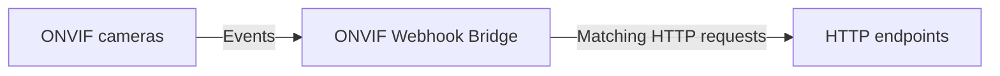

# ONVIF Webhook Bridge

A free, self-hosted application that turns ONVIF camera events into configurable HTTP webhooks. Connect multiple IP cameras, inspect their events, and configure forwarding rules in your browser. Run it with Docker Compose on a compatible Linux host, including a NAS with Linux container support.

Connect camera event producers to systems that accept HTTP requests but cannot consume those ONVIF events directly. The original motivation was forwarding camera AI detection events to QNAP QVR Pro's HTTP event mechanism; the bridge is generic and has no QNAP dependency.

## Features

- **Multiple cameras:** independent ONVIF PullPoint connections, lease renewal and automatic reconnection.
- **Event Explorer:** inspect received topics, Source/Data/Key fields and retained XML, including false and unmatched notifications. Draft rules from observed events.
- **Configurable forwarding:** exact topic and optional text/boolean field matching, occurrence or transition modes, cooldowns, GET or POST, custom headers and literal JSON bodies.
- **Browser administration:** manage cameras and rules, check connection status, test saved HTTP actions, and inspect recent delivery results.
- **Persistent configuration:** cameras, rules and administrator setup survive container recreation in a SQLite data volume.
- **Self-contained deployment:** one .NET NativeAOT process serves the UI, polls cameras and delivers actions; no external database or frontend service is needed.
- **Protected administration:** one administrator, no default credentials, bounded sessions, CSRF protection and masked secret reads. Recoverable camera and webhook secrets require private storage; see [security](SECURITY.md).

## How it works



Add camera device-service URLs explicitly. The bridge discovers each camera's event service, subscribes, and keeps a bounded recent event history. Rules select which observations produce HTTP requests; a failed camera or action does not stop the other camera connections.

## Quick start

You need Git, Docker with Compose, and a Linux container engine on an amd64 or arm64 host. This procedure **builds locally**; it does not depend on an available registry image. See [deployment evidence](docs/DEPLOYMENT_VERIFICATION.md) for platform verification and remaining hardware gates.

```sh
git clone https://github.com/dombrovsky/onvif-webhook-bridge.git
cd onvif-webhook-bridge
cp .env.example .env
```

Until the repository is public, cloning requires authorized GitHub access.

1. Edit `.env`: replace `ONVIF_ADMIN_USERNAME` with your chosen administrator name. Keep `ONVIF_IMAGE=onvif-webhook-bridge:local` for this local build and keep the loopback bind default.
2. Create the file specified by `ONVIF_ADMIN_PASSWORD_PATH` (default `./.local/administrator-password`). Put a unique password of 12–4096 UTF-16 units in this UTF-8 file; a trailing newline is removed. Keep the password out of `.env`, command arguments and Git.
3. Restrict the password file and its parent directory. The container runs as UID/GID **1654:1654** and must be able to read the mounted file. On a conventional Linux Docker host, keep `.local` private to the operator (`0700`) and give the file owner `1654:1654` with mode `0600`. Compose does not reliably remap file-secret permissions. NAS ACLs and rootless Docker may require host-specific ownership setup; see [password-file and volume requirements](docs/DEPLOYMENT.md#first-start).

Then run from the repository directory:

```sh
docker compose config --quiet
docker compose build
docker compose up -d
docker compose ps
```

Open [http://localhost:8080](http://localhost:8080) **on the Docker host** and sign in with the credentials you configured. The default is `127.0.0.1:8080` on the host, forwarding to port `8080` in the container. For a remote NAS, use a secure tunnel or the documented [HTTPS proxy setup](docs/DEPLOYMENT.md#https-and-trusted-certificates); changing the bind address alone does not secure remote access.

Compose creates the persistent `bridge-data` volume at `/data`. Keep it across upgrades and back it up securely. Administrator variables initialize only a new database; changing the password file later does not change the existing login. Keep the file available for Compose and use the documented [offline reset](docs/ADMINISTRATION.md#explicit-offline-password-reset) when needed.

### Forward your first event

1. In **Cameras**, choose **Add camera**, enter its ONVIF device-service URL and credentials, and enable the connection. **Test connectivity** checks reachability; wait for subscription status separately.
2. Open **Event Explorer**, generate a detection at the camera, and inspect the actual topic and fields. Event support depends on the camera and its existing configuration.
3. Draft a rule from the observed topic or a scalar Source/Data field. Review the match and set your HTTP destination, method and optional headers/JSON. New rules save **disabled**. Mark URLs containing tokens as sensitive.
4. Use the rule's manual HTTP test and inspect its execution result. **This sends a real request**, even for a disabled rule; the camera must be enabled. A 2xx response confirms HTTP acceptance, so verify the intended effect at the destination separately.
5. Enable the reviewed rule, generate another event, and check delivery. Use occurrence mode initially; transition mode needs a verified activation/reset cycle and stable event identity.

See [browser administration](docs/BROWSER_ADMINISTRATION.md) for matching, secrets, retries and execution details. Retries are off by default and can duplicate external actions.

## Example uses

- Forward detection events to QNAP QVR Pro through its HTTP event mechanism, using a destination URL configured for that system.
- Trigger home automations that expose HTTP webhook endpoints.
- Send camera events to a custom application's HTTP handler using a configured GET or literal JSON POST.

These are integration possibilities, not claims of end-to-end verification with those products. Automated delivery tests use an ONVIF simulator and local HTTP recorders; real destination effects remain unverified.

## Documentation

- [Deployment, upgrades, backup and troubleshooting](docs/DEPLOYMENT.md)
- [Browser configuration, Event Explorer and rules](docs/BROWSER_ADMINISTRATION.md)
- [Administrator setup, password reset and API](docs/ADMINISTRATION.md)
- [Data storage and permissions](docs/DATA_STORAGE.md)
- [Security and reporting vulnerabilities](SECURITY.md)
- [Development, tests and diagnostic probe](docs/DEVELOPMENT.md)

Sanitized screenshots are still needed for the Overview, Event Explorer and rule editor; see the [screenshot checklist](docs/BROWSER_ADMINISTRATION.md#screenshots).

## Compatibility and limitations

- Cameras must expose a reachable ONVIF event service with PullPoint support. Manufacturer and firmware differences affect topics, fields, authentication and subscriptions; ONVIF branding alone does not establish compatibility. There is no automatic camera discovery.
- The standalone probe received initialization events, renewed subscriptions and shut down cleanly on one real device. Full detection activation/reset, real-device outage/reboot recovery and real destination effects remain pending. See [device observations](docs/ONVIF_OBSERVATIONS.md), [deployment evidence](docs/DEPLOYMENT_VERIFICATION.md) and [current UI verification](docs/UI_REDESIGN_VERIFICATION.md).
- Docker targets are `linux/amd64` and `linux/arm64`. Both have native hosted CI evidence; operator NAS/hardware compatibility still needs verification. ARMv7 is excluded and Linux 32-bit x86 is unsupported.
- Event history and delivery results are bounded and in memory. Restart clears history, sessions, transition state, cooldowns and queued work. Events missed during disconnection are not replayed; delivery is not durable or exactly once.
- This is an event bridge. It does not stream or record video, proxy RTSP, or provide MQTT integration.

## Contributing and support

Report bugs and request features through [GitHub Issues](https://github.com/dombrovsky/onvif-webhook-bridge/issues). Include the revision, architecture and sanitized reproduction steps; keep credentials, device identities, private addresses and event payloads out of reports. Use the [security policy](SECURITY.md) for vulnerabilities.

For contributions, start with the [developer guide](docs/DEVELOPMENT.md) and [repository instructions](AGENTS.md). Keep changes focused and discuss substantial additions in an issue first. The project is free and open source under the [MIT License](LICENSE).

## Optional sponsorship

If you find the project useful, you can [sponsor its maintainer](https://github.com/sponsors/dombrovsky). Sponsorship is entirely optional; all features are available without payment.
